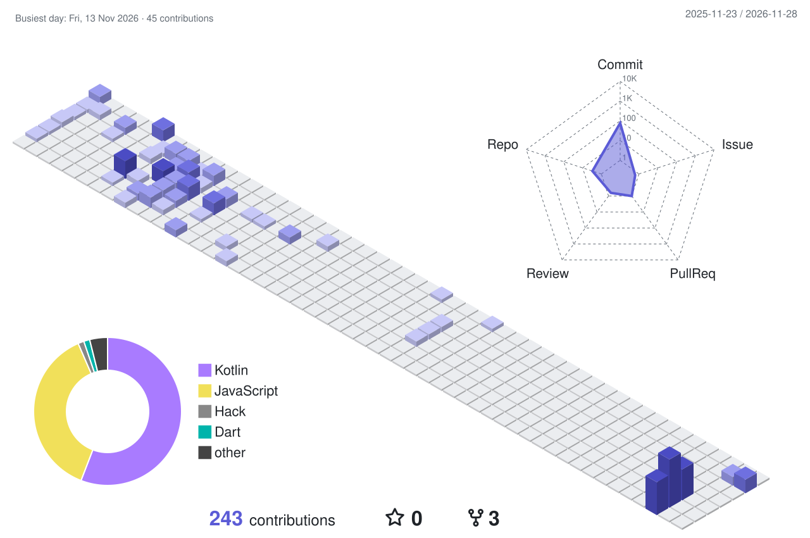

<picture>
  <source media="(prefers-color-scheme: dark)" srcset="assets/banner-dark.svg">
  
</picture>

I build Android apps, backend APIs and web dashboards, mostly in Kotlin, C# and React.
By day I'm a software developer at Atmytip Software Solutions in Pune; after hours I make small,
privacy-first apps for myself. I'm into cybersecurity: I think about how an app could be attacked
while I build it, and my own apps keep their secrets encrypted with the Android Keystore.
I like hackathons, and won Smart India Hackathon 2023.

[Portfolio](https://srihari-prasath.vercel.app/) &nbsp;·&nbsp;
[LinkedIn](https://linkedin.com/in/Srihari-prasath-athirajasekar) &nbsp;·&nbsp;
[Instagram](https://instagram.com/mr_stoic_chad)

### Stack

<picture>
  <!-- commas are written as %2C: srcset treats a bare comma as the start of another image -->
  <source media="(prefers-color-scheme: dark)" srcset="https://skillicons.dev/icons?i=kotlin%2Candroidstudio%2Cswift%2Cflutter%2Cdart%2Ccs%2Cdotnet%2Creact%2Cts%2Cjs%2Cvite%2Cnodejs%2Cmysql%2Cmongodb%2Cfirebase%2Cpy%2Ctensorflow%2Cgit&perline=9&theme=dark">
  
</picture>

### Numbers

<picture>
  <source media="(prefers-color-scheme: dark)" srcset="https://raw.githubusercontent.com/Srihari-Prasath/Srihari-Prasath/output/stats-dark.svg">
  
</picture>
<picture>
  <source media="(prefers-color-scheme: dark)" srcset="https://raw.githubusercontent.com/Srihari-Prasath/Srihari-Prasath/output/languages-dark.svg">
  
</picture>

<picture>
  <source media="(prefers-color-scheme: dark)" srcset="https://raw.githubusercontent.com/Srihari-Prasath/Srihari-Prasath/output/trophies-dark.svg">
  
</picture>

### Contributions

<picture>
  <source media="(prefers-color-scheme: dark)" srcset="https://raw.githubusercontent.com/Srihari-Prasath/Srihari-Prasath/output/3d-dark.svg">
  
</picture>
Click the graph, then hover any block to see that day's contributions.

<picture>
  <source media="(prefers-color-scheme: dark)" srcset="https://raw.githubusercontent.com/Srihari-Prasath/Srihari-Prasath/output/snake-dark.svg">
  
</picture>

<picture>
  <source media="(prefers-color-scheme: dark)" srcset="https://streak-stats.demolab.com?user=Srihari-Prasath&border_radius=10&background=0D1117&border=30363D&stroke=21262D&ring=9B9CF9&fire=9B9CF9&currStreakNum=E6EDF3&sideNums=E6EDF3&currStreakLabel=9B9CF9&sideLabels=8B949E&dates=8B949E">
  
</picture>
<picture>
  <source media="(prefers-color-scheme: dark)" srcset="https://quotes-github-readme.vercel.app/api?type=horizontal&theme=dark">
  
</picture>

The cards above redraw every night through <a href=".github/workflows/profile.yml">a GitHub Action</a> in this repo.
&nbsp;

